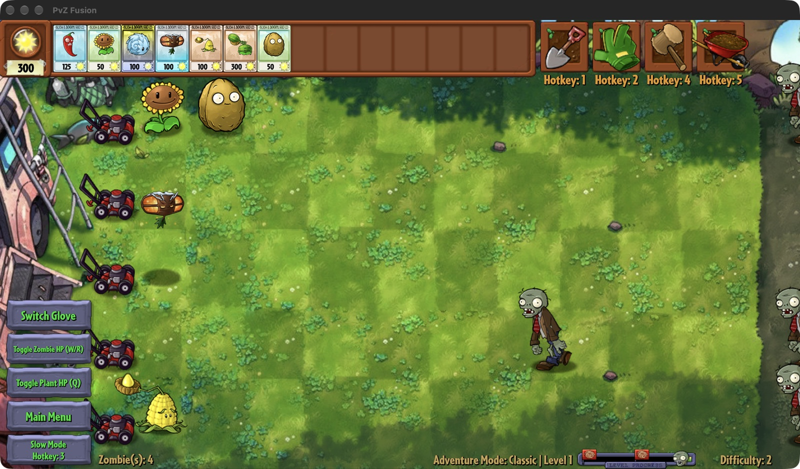
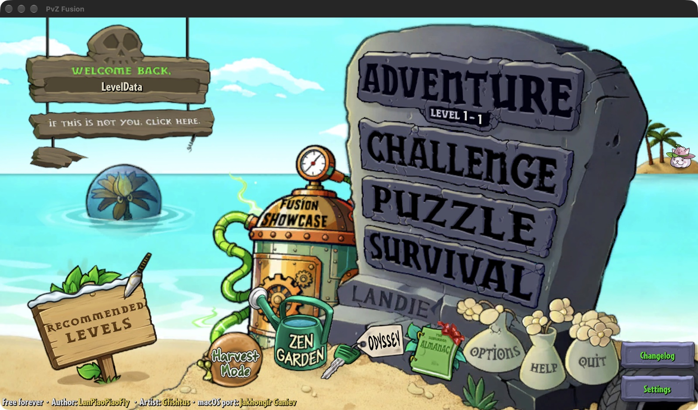
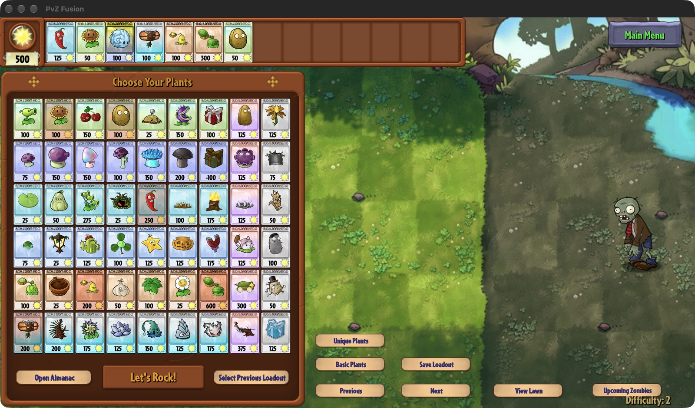
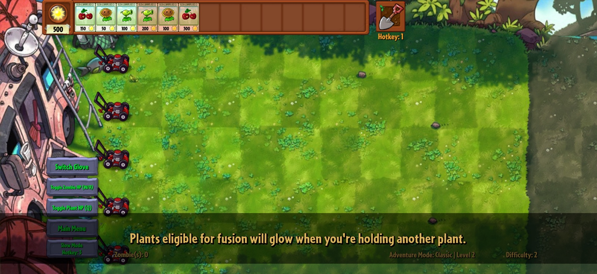

# PvZ Fusion for Mac and iPhone (macOS, Apple Silicon, iOS)

Play **Plants vs. Zombies Fusion** (PvZ Fusion, English translation) on your Mac or iPhone. These are native apps for Apple Silicon Macs (M1, M2, M3, M4) and for iPhone; neither is an emulator or a phone simulator.

[](https://github.com/ganiyevuz/PvZ-Fusion-macOS/releases/latest)
[](https://github.com/ganiyevuz/PvZ-Fusion-macOS/releases)

<p align="center">
  
</p>
<p align="center">
  
  
</p>
<p align="center">
  
</p>

This repository hosts the downloads. A new version is published here when the English translation releases one.

---

## Download

Get the latest release from the **[Releases page](https://github.com/ganiyevuz/PvZ-Fusion-macOS/releases/latest)**: the `.dmg` for a Mac, the `.ipa` for an iPhone (see [iPhone](#iphone) below).

## Installation

1. Open the DMG and drag **PvZ Fusion** into your Applications folder.
2. **First launch only:** open the app once (macOS will block it), then go to **System Settings → Privacy & Security** and click **Open Anyway**. Or run:

   ```bash
   xattr -dr com.apple.quarantine "/Applications/PvZ Fusion.app"
   ```

> The app is not signed with an Apple Developer account, so macOS blocks it until you allow it once. After that it opens normally.

## Requirements

- Apple Silicon Mac (M1, M2, M3, M4 or later)
- macOS 12 Monterey or later

Intel Macs are not supported.

## Good to know

- **Hotkeys:** the game's keyboard shortcuts work; see [Keyboard shortcuts](#keyboard-shortcuts) below.
- **Frame rate:** the game runs at 60 fps. On a 120 Hz (ProMotion) display you can switch to 120 fps in **View → Frame Rate**; the choice is remembered.
- **Updates:** at launch the app checks this page for a newer version and offers it once; **PvZ Fusion → Check for Updates…** checks any time. To turn the launch check off: `defaults write dev.kotib.pvzf-macos CheckForUpdates -bool NO`.
- **Saves** are kept in `~/Library/Application Support/pvzf/pvzf-macos`, so updating the app keeps your progress. To update, drag the new version over the old one.
- **If macOS asks to reopen windows** after the game was closed unexpectedly, just dismiss it.

## iPhone

The `.ipa` isn't signed: you sign it with your own Apple ID when you install it.

1. Install [Sideloadly](https://sideloadly.io) (Mac or Windows) or [AltStore](https://altstore.io).
2. Connect your iPhone, drop `PvZ-Fusion-iOS-<version>.ipa` into it, and sign in with your Apple ID.
3. On the iPhone, the first time: turn on **Settings → Privacy & Security → Developer Mode**, and trust your Apple ID under **Settings → General → VPN & Device Management**.

With a free Apple ID the app has to be reinstalled every 7 days to keep opening; your saves stay.

- **Needs** iOS 17 or later. Made and tested on an iPhone 17 Pro; older iPhones may not have enough memory.
- **Full screen:** the game fills the screen and keeps its buttons clear of the rounded corners, the Dynamic Island and the home bar.
- **Up to 120 fps** on ProMotion iPhones (60 in Low Power Mode, or while the phone runs hot).
- **Sound** plays with silent mode on too.
- **Saves** are in the Files app: **On My iPhone → PvZ Fusion → Save Data**. Copy that folder to back them up.
- **Fan music:** the PC mods' music pack plays in place of the game's own tracks, as with the Mac's Fan Music switch on (always on; the iPhone has no menu bar). Credits are below.
- **Not on iPhone:** the Mac's other View-menu extras (Hide Metal Objects, Fusion Shortcuts) and keyboard hotkeys. The game's Screen Mode setting is for PC windows and does nothing on a phone.

## Keyboard shortcuts

### The game's hotkeys

The game lists these on its Credits screen. On a Mac keyboard:

| Key | What it does | On a Mac |
|---|---|---|
| **1** | Shovel | Same key, works as is |
| **2** | Gloves | Same key, works as is |
| **3** | Slow Mode | Same key, works as is |
| **4** | Mallet | Same key, works as is |
| **5** | Wheelbarrow | Same key, works as is |
| **Q** | Show plant health | Same key, works as is |
| **W / R** | Show zombie health | Same key, works as is |
| **E** | Coffee Bean | Same key, works as is |
| **P** | Switch Kirov sound effects | Same key, works as is |
| **V** | Switch gloves | Same key, works as is |
| **C** | Look up the plant under the mouse in the Almanac | Same key, works as is |
| **H** | Show the stats of the plant under the mouse | Same key, works as is |
| **R** | Turn a plant around before planting, in TD mode | Same key, works as is |
| **B** | Open Plant Storage during a level | Same key, works as is |
| **T** | Show projectile damage | Same key; turn it on in the game's settings first |
| **F** | Full screen | macOS full screen (also **Ctrl + Cmd + F**) |
| **F1** | Hide / show the game's interface | **fn + F1** |
| **F10** | Hide / show metal objects | **fn + F10**; flips **View → Hide Metal Objects** |
| **Insert** | Open the save folder | **fn + Return**, or keypad Enter |
| **Page Up** | Open the online Almanac | **fn + ↑** |
| **Left Shift** (hold while planting) | Fuse with the pumpkin around a plant | Left **Shift**, with **View → Fusion Shortcuts** on |
| **Left Alt** (hold while planting) | Fuse with the pot under a plant | Left **Option**, with **View → Fusion Shortcuts** on |

The function keys need **fn** unless "Use F1, F2, etc. keys as standard function keys" is on in **System Settings → Keyboard**. Some mini-games have their own keys (WASD, Space, the arrow keys); their tips show them.

### The Mac app

| Keys | What they do |
|---|---|
| **Cmd + Q** | Quit |
| **Cmd + H** / **Option + Cmd + H** | Hide the game / hide other apps |
| **Cmd + M** | Minimize |
| **Ctrl + Cmd + F** or **F** | Full screen |
| **Return** / **Escape** | In a text box (a profile name, for example): confirm / cancel |
| **Cmd + V** | Paste into a text box |

Keys pressed with **Cmd** go to the menu bar, never to the game. The mouse wheel and trackpad scrolling go to the game. The **View** menu holds the switches (Frame Rate, Sharpen Picture, Fan Music, Hide Metal Objects, Fusion Shortcuts), and **PvZ Fusion → Check for Updates…** checks for a new version.

## Music and PC mods

Three extras from the PC version, all in the **View** menu:

- **Fan Music** (on by default): the PC mods' music pack replaces the game's own music for the main menu, Zen Garden, each adventure area (with its drum layer), the boss and more: fan-made tracks, and the original game soundtrack for the rest. Untick **View → Fan Music** to hear the game's own music; the change applies from the next track. When a track hasn't been loaded yet, the game's own plays for a moment while it loads in the background, and then the new one takes over. The music comes from the PC translation project, [Teyliu/PVZF-Translation](https://github.com/Teyliu/PVZF-Translation); credits are below.
- **Hide Metal Objects** (off by default): turn it on in **View → Hide Metal Objects**, or press **F10** (fn + F10) as on PC, to hide the metal items zombies drop. It's from the PC "Blooms_QOL" mod by Blooms. Turning it off doesn't bring back items already hidden.
- **Fusion Shortcuts (Option/Shift)** (on by default): while planting, hold left **Option** to fuse the seed with the pot under a plant, or left **Shift** to fuse it with the pumpkin around it. Holding either also keeps a plant marked by the Super Machine Nut shortcut from being healed back, and with either held the Super Machine Nut fuses with the pot or pumpkin instead of its normal summon. From the PC "Blooms_QOL" mod (Better Fusion Suite) by Blooms. Turn it off in **View → Fusion Shortcuts (Option/Shift)**.

**Greyed out after a game update?** Fusion Shortcuts relies on the game's internal plant numbers, so it only works on the game version it was checked on (4.0.5-release-3). After a game update it shows greyed out, "unavailable in this game version", until it is checked again. Every extra switches itself off and greys its menu item if an update removes something it needs; the game keeps running normally.

## Problems?

Open an [issue](https://github.com/ganiyevuz/PvZ-Fusion-macOS/issues) and include your macOS version and Mac model (for example "macOS 15.2, MacBook Air M2"), or your iOS version and iPhone model.

## Credits

- **macOS & iOS port** — Jakhongir Ganiev ([jakhongir.dev](https://jakhongir.dev), [@ganiyevuz](https://github.com/ganiyevuz)). The game's own Credits screen lists it too.
- **PvZ Fusion** — the original Chinese fan-made game, by its authors. All game content and assets belong to them.
- **English translation** — [silvershadowkat/pvzf-android-translation](https://github.com/silvershadowkat/pvzf-android-translation). Each release repackages that project's Android release for Mac and iPhone.
- **ELF loader** — based on the Nintendo Switch port [ChanseyIsTheBest/pvz_fusion_en_nx](https://github.com/ChanseyIsTheBest/pvz_fusion_en_nx).
- **Music (PC mods' music pack, View → Fan Music; always on iPhone)** — Main Menu, Zen Garden - Starry Ceiling, GarZen Flora by Rollerlhite @ https://www.youtube.com/watch?v=aBj1MfvnHPE. Adventure Music - Lumi-Lawn (Day), Undead of the Night (Night), GhOuL pOoL (Pool), Mortemlights (Fog), Praize the Hills (Roof), Brainless Wit, Steamroller, "Boss2" by Xabdi @ https://youtube.com/playlist?list=PLuKXe1tVSw8Sh4K5qrUn65gbRaVNTeqjs&si=heuMbZmlYoAGUf6M. Everything Else - Original Game Soundtrack by Laura Shigihara @ https://www.youtube.com/playlist?list=PLBO2h-GzDvIbpXmK3uTNi6Fe_SE5sTFLY. Music files come from [Teyliu/PVZF-Translation](https://github.com/Teyliu/PVZF-Translation).
- **Hide Metal Objects and Fusion Shortcuts** — from the PC "Blooms_QOL" mod by Blooms.

## Sharing or modifying

You're welcome to share this app or build on the port. When you do, **credit Jakhongir Ganiev ([jakhongir.dev](https://jakhongir.dev)) and link to this repository**. The port is MIT-licensed, so its copyright notice and license (inside the Mac app at `Contents/Resources/Licenses/LICENSE.txt`, inside the iPhone app at `Licenses/LICENSE.txt`) must stay with any copy or modified version. Both also include a `Credits.txt`.

PvZ Fusion's game files and assets are not covered by that license; they belong to their authors.

---

Plants vs. Zombies is a trademark of Electronic Arts. This is an unofficial fan project and is not affiliated with PopCap or EA.
